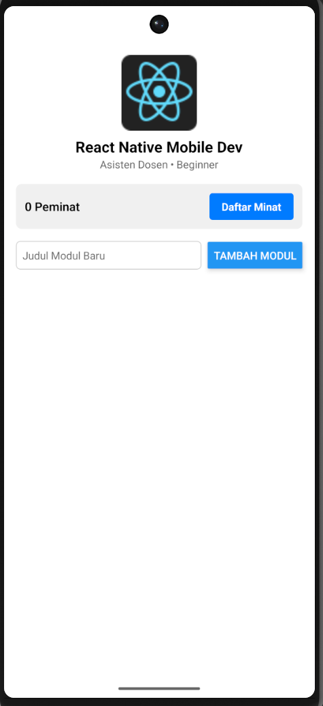
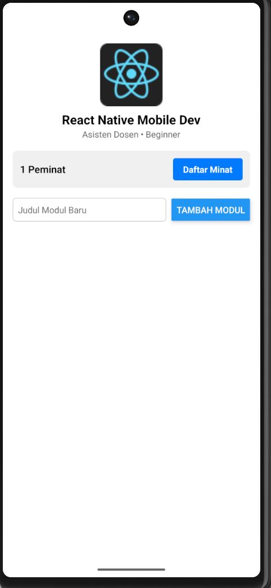
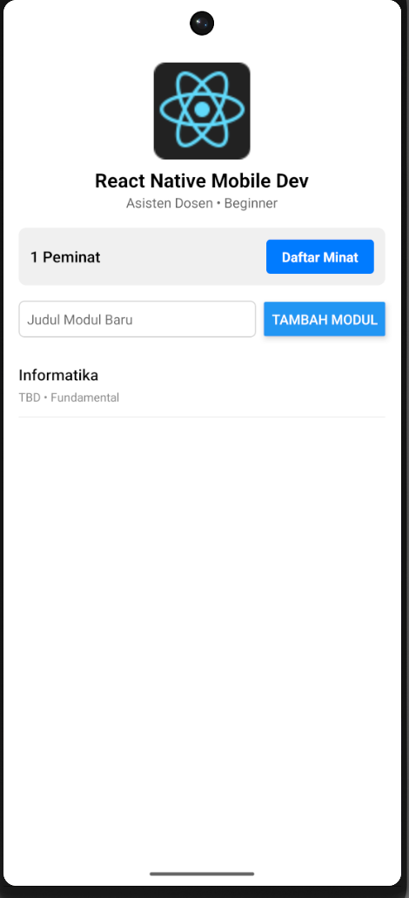

# EduCourseApp

## Identitas Mahasiswa
- **Nama:** M Raditya Zauhair
- **NIM:** 2555200012
- **Jurusan:** Informatika

## Studi Kasus
Studi Kasus 2: EduCourseApp (Kartu Silabus Kursus & Modul Belajar)

## Penjelasan Ringkas Alur State
1. **Interaksi Counter (Angka):** Menggunakan hook `useState` untuk menyimpan jumlah peminat kelas. Nilai peminat kelas akan bertambah +1 setiap kali tombol ditekan melalui fungsi pembaruan *state*.
2. **Form Dinamis (Array):** Menggunakan `useState` untuk mengelola teks input dan *array* data modul. Pembaruan *array* dilakukan secara *immutable* menggunakan *spread operator* `[...prev, newItem]` untuk me-render modul baru ke daftar silabus, yang kemudian diikuti dengan proses mereset input teks menjadi kosong.

## Screenshot Aplikasi Berjalan

